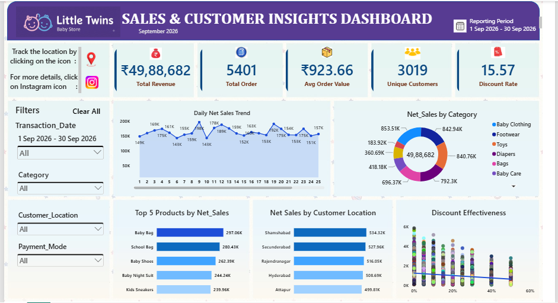

# 👶 Little Twins Baby Store — Retail Customer & Discount Effectiveness Dashboard

## 🎯 Project Overview

This project focuses on analyzing September 2026 sales data for Little Twins Baby Store using Microsoft Power BI.

The objective is to evaluate retail sales performance, understand customer purchasing patterns, identify high-performing product categories and locations, and analyze the impact of discounts on sales revenue.

An interactive dashboard was developed to transform raw transaction data into meaningful business insights and support data-driven decision-making.

## 📁 Business Objectives

- Monitor overall sales performance.
- Analyze daily revenue trends.
- Identify top-performing product categories and products.
- Understand customer location-wise sales performance.
- Explore the relationship between discount percentages and net sales.
- Provide interactive insights for business stakeholders.
  

## 📁 Dataset & File Structure

- **Repository Artifacts:**
- **Data Used:** < a href="https://github.com/Shanawaz8002/September-Analysis-Dashboard/blob/main/Little_Twins_September_2026.csv"> (Clean Data File)
- **Interactive Power Bi Dashboard:** < a href="https://github.com/Shanawaz8002/September-Analysis-Dashboard/blob/main/September-Dashboard.png"> (Interactive Power Bi Dashboard)
- **SQL Analytics Scripts:** < a href="https://github.com/Shanawaz8002/September-Analysis-Dashboard/blob/main/%F0%9F%93%8A%20LittleTwins_September_Sales%20%7BSQL%20Queries%7D.docx"> (SQL Analytics Scripts)

## 📌 Key Performance Indicators (KPIs)

The dashboard includes five key performance indicators:

| KPI | Description |
|---|---|
| Net Sales | Total revenue after deducting discounts. |
| Total Orders | Total number of unique transactions. |
| Average Order Value (AOV) | Average net sales revenue per transaction. |
| Unique Customers | Total number of distinct customers. |
| Discount Rate (%) | Total discount amount divided by total gross sales. |

## 📄 Dashboard Visualizations

The dashboard contains five major visualizations:

1. **Daily Net Sales Trend** — A line chart showing daily revenue fluctuations throughout September 2026.
2. **Net Sales by Product Category** — A donut chart showing each product category's contribution to total net sales.
3. **Top 5 Products by Net Sales** — A horizontal bar chart identifying the five highest-revenue products.
4. **Net Sales by Customer Location** — A bar chart comparing sales performance across customer locations.
5. **Discount Effectiveness** — A scatter chart exploring the relationship between discount percentages and transaction-level net sales.

## 🔑 Interactive Features

The dashboard includes interactive slicers for:

- Transaction Date
- Product Category
- Customer Location
- Payment Mode

All KPI cards and visualizations respond dynamically to the selected filters, allowing users to explore different aspects of business performance.

## ⚙ Tools & Technologies

- **Microsoft Excel** — Data inspection and preparation.
- **Power Query** — Data cleaning, transformation and validation.
- **SQL** -  KPI calculations and analytical measures.
- **Microsoft Power BI** — Interactive dashboard development.
- **DAX** — KPI calculations and analytical measures.

## 🧹 Data Cleaning & Preparation

The raw September sales dataset was prepared for analysis through several data-cleaning activities:

- Handling missing and inconsistent values.
- Identifying and removing duplicate records.
- Standardizing product names and categories.
- Validating transaction dates.
- Checking quantity and unit price values.
- Calculating and validating Gross Sales, Discount Amount and Net Sales.
- Checking discount percentages and financial calculation consistency.

## ⏳ Business Value

This dashboard helps business stakeholders:

- Monitor monthly sales performance.
- Identify products and categories contributing the most revenue.
- Understand sales distribution across customer locations.
- Evaluate discount patterns and their relationship with transaction revenue.
- Explore business performance through interactive filters.

## Project Limitations

- Profitability cannot be calculated without product costs and operating expenses.
- Inventory performance cannot be evaluated without stock and purchase records.
- Discount effectiveness analysis identifies relationships, not direct causation.
- Customer retention analysis requires reliable historical customer transaction data.

## 📊 Interactive Dashboard Preview

  

## 📃 Reporting Period

**September 1–30, 2026**

## 👨‍💻 Author

**Shahnawaz Khan**

Data Analytics | SQL | Excel | Power BI | Python

---

*This project is part of my Retail Data Analytics portfolio, demonstrating practical data cleaning, KPI development, business analysis and interactive dashboard design.*
